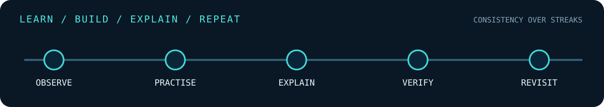

# CYBER LEARNING LOG
> **Kaden Younis · Learn → practise → explain → revisit**

This repository is my ongoing technical notebook for **cybersecurity, computer systems, networking, programming and security analysis**.

It complements my [project portfolio](https://github.com/kadencybsec/cybersecurity-projects), but it is not tied to any single course, project count or calendar. I use it to record what I learned, why a command worked, how I solved a problem, what failed and what I want to revisit.

## Where to look

| Topic | Contents |
|:--|:--|
| [Linux](notes/linux/README.md) | Commands, filesystem, processes, permissions and administration concepts |
| [Networking](notes/networking/README.md) | TCP/IP, DNS, routing, HTTP/TLS and packet analysis |
| [Python](notes/python/README.md) | Scripting, testing, file processing and simple automation |
| [Security](notes/security/README.md) | Security principles, detection, hardening and threat modelling |
| [HTB and CTF reflections](htb-ctf/README.md) | Learning from authorised challenges, without active spoilers |
| [Initial baseline](notes/2026-11-baseline.md) | My documented starting point |

## How I keep notes

1. **Observe:** Describe the problem or concept.
2. **Practise:** Try it in a system I own or an authorised training lab.
3. **Explain:** Record what my commands, code and decisions actually do.
4. **Verify:** Run a test or compare to trustworthy documentation.
5. **Revisit:** Repeat later without simply copying a tutorial.

Useful reusable templates: [weekly review](templates/weekly-review.md) · [command explanation](templates/command-card.md) · [lab report](templates/lab-writeup.md) · [CTF reflection](templates/ctf-reflection.md).

## Current study routine

The 2026–2028 project schedule provides a useful starting cadence, but the repository will continue beyond it.

| Session | Typical use |
|:--|:--|
| Foundations | Command recall, networking, OS or programming concepts |
| Guided learning | HTB Academy, TryHackMe or structured course exercises |
| Practical work | Lab experiments, independent projects and debugging |
| Review | Testing, GitHub documentation and next-step planning |
| Reflection | CTF notes, mistakes, new questions and ideas |

## What this notebook is not

This is **not** an automatically updated HTB scorecard, a claim of professional experience, or a copy of tutorials. A note records learning. A completed portfolio item must also demonstrate reproducible evidence.

Follow the [project index](https://github.com/kadencybsec/cybersecurity-projects/blob/main/PORTFOLIO.md) for selected finished work.

**Publishing standard:** No credentials, personal data, private network details, live malware, or challenge spoilers that violate platform rules.
